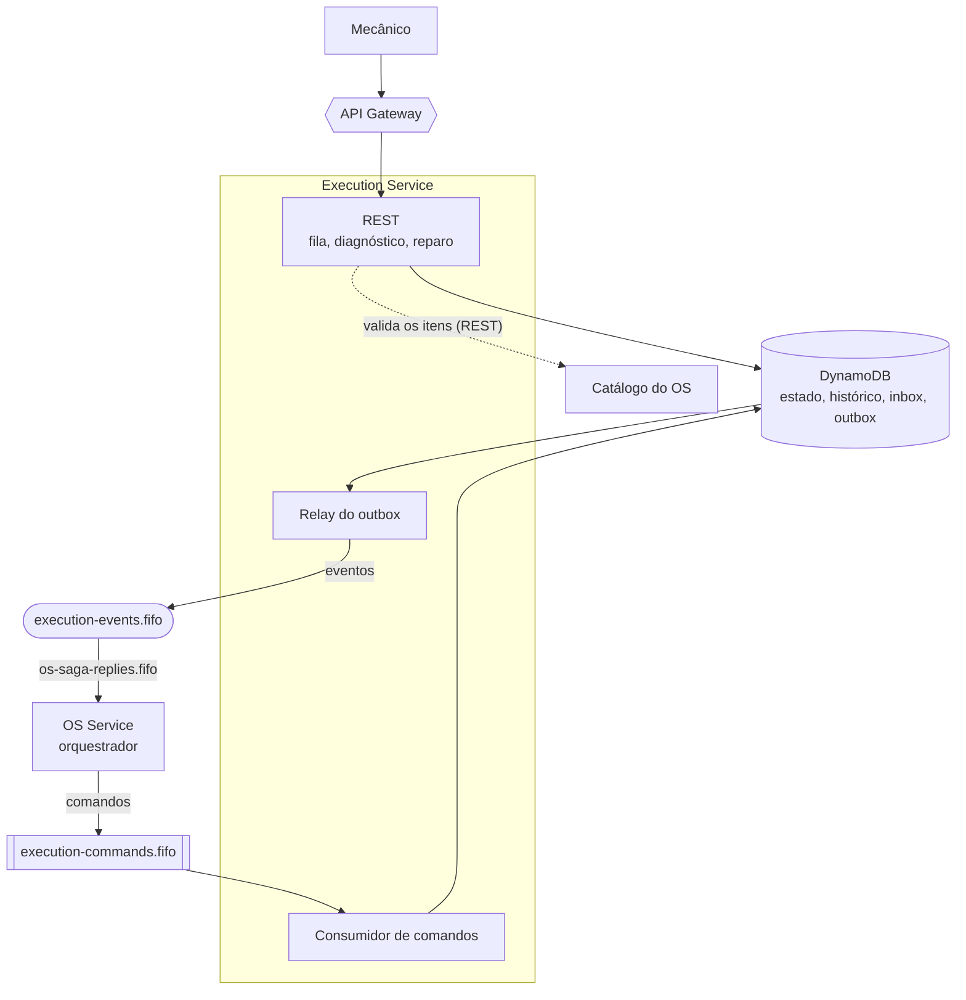
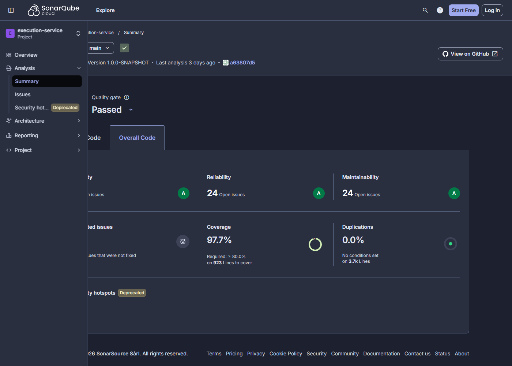

# fiap-fase4-execution-service

Execution Service da Fase 4 do Tech Challenge (FIAP SOAT): **fila de diagnóstico e reparo por filial**, em
DynamoDB. Quarkus 3.26.3, Java 17, Clean Architecture com ArchUnit.

> Arquitetura em
> [fiap-fase4-os-service/docs/arquitetura](https://github.com/CleytonOngaratto/fiap-fase4-os-service/tree/main/docs/arquitetura).
> O modelo da tabela está na
> [ADR-009](https://github.com/CleytonOngaratto/fiap-fase4-os-service/blob/main/docs/arquitetura/adr/ADR-009-tabela-unica-do-execution.md).

## O papel na Saga

A Saga é **orquestrada**, e o orquestrador vive no OS Service. Este serviço é **participante**: recebe comandos
numa fila FIFO, guarda o próprio estado e devolve eventos. Ele nunca decide o processo — decide só o que é dele:
em que ponto da execução cada ordem de serviço está.

Três regras valem para tudo o que ele faz:

1. **Comando responde uma vez por `messageId`.** Quem decide se a mensagem já foi tratada é a *inbox*, não o
   estado do item: a reentrega não produz segundo efeito **nem segunda resposta**.
2. **`CancelDiagnosis` responde sempre** — inclusive quando não existe diagnóstico nenhum, e inclusive quando o
   item já terminou em falha. Calar nesses casos deixaria a saga em `COMPENSATING` para sempre, porque esse
   passo é o último de toda lista de compensação e espera confirmação.
3. **Falha de negócio é evento de resposta, nunca exceção que sobe.** `DiagnosisFailed` e `RepairFailed` são
   gravados na mesma transação do estado. O que sobe como exceção é falha técnica — e aí a mensagem fica na fila.

### Comandos que consome

Fila `execution-commands.fifo` (deste repositório; o orquestrador a lê no SSM para escrever nela).

| Comando | O que faz | Responde |
|---|---|---|
| `StartDiagnosis` | põe a ordem na fila de diagnóstico da filial (`DIAGNOSIS_QUEUED`) | nada agora — quem responde é o mecânico, ao iniciar |
| `CancelDiagnosis` | encerra o item, se houver o que encerrar | `DiagnosisCanceled`, **sempre** |
| `StartRepair` | põe a ordem na fila de reparo (`REPAIR_QUEUED`), com os itens do orçamento | nada agora — quem responde é o mecânico |

Comando de tipo desconhecido é registrado e descartado; deixá-lo na fila travaria todas as mensagens da mesma
ordem de serviço, porque a fila é FIFO por OS. Conflito de estado também sai da fila, pelo mesmo motivo. O que
**não** sai é falha técnica: a mensagem volta, esgota as tentativas e para na fila de descarte.

### Eventos que publica

Tópico `execution-events.fifo` (da plataforma), por **outbox**: o evento nasce como item na mesma
`TransactWriteItems` que grava o estado, e um *relay* agendado publica depois.

| Evento | Quando | Payload |
|---|---|---|
| `DiagnosisStarted` | mecânico inicia o diagnóstico | `mechanic`, `startedAt` |
| `DiagnosisCompleted` | mecânico conclui, com descrição e itens validados | `description`, `items[{type, catalogId, quantity}]` |
| `DiagnosisFailed` | mecânico registra que não há reparo viável | `reason` |
| `DiagnosisCanceled` | resposta a `CancelDiagnosis` | — |
| `RepairStarted` | mecânico inicia o reparo | `startedAt` |
| `RepairCompleted` | mecânico conclui o reparo — é o **pivô** da saga | `completedAt` |
| `RepairFailed` | mecânico registra falha no reparo | `reason` |

**O preço não sai daqui.** `DiagnosisCompleted` leva o que foi diagnosticado; quem precifica é o catálogo do OS,
e o valor fica congelado no snapshot dele. O envelope e o significado de cada campo estão no
[catálogo de mensagens](https://github.com/CleytonOngaratto/fiap-fase4-os-service/blob/main/docs/arquitetura/catalogo-de-mensagens.md).

## Tecnologias

| Tecnologia | Versão | Uso |
|---|---|---|
| Java | **17** | linguagem; imagem `eclipse-temurin:17-jre-jammy` |
| Quarkus | **3.26.3** | REST, CDI, configuração e agendamento |
| Amazon DynamoDB (AWS SDK for Java v2) | 2.32.4 | banco do serviço, numa tabela única |
| AWS SDK for Java v2 (SQS e SNS) | 2.32.4 | fila de comandos e tópico de eventos |
| SmallRye JWT | 4.6.2 | valida o token RS256 |
| SmallRye OpenAPI e Swagger UI | 4.0.12 | especificação da API |
| Micrometer com Prometheus | 1.14.7 | métricas |
| New Relic Java Agent | 9.4.0 | APM, traço distribuído e logs |
| JUnit 5 · Mockito · REST Assured | 5.13.4 · 5.18.0 · 5.5.6 | testes de unidade e de API |
| Testcontainers · WireMock | 1.21.3 · 3.13.2 | testes com DynamoDB Local e filas reais, e o catálogo do OS simulado |
| ArchUnit | 1.3.0 | regras de arquitetura |
| JaCoCo | 0.8.12 | cobertura e gate do build |
| SonarCloud (`sonar-maven-plugin`) | 5.8.0.7211 | análise de qualidade no CI |
| Trivy | 0.58.0 | varredura de vulnerabilidades no CI |
| DynamoDB Local · ElasticMQ | 2.5.2 · 1.7.1 | ambiente local e testes |
| Terraform · provider AWS | 1.15.4 · 6.57.1 | infraestrutura do serviço |
| Amazon EKS · kubectl | 1.36 (medido em 2026-10-11) · 1.35.9 | execução e deploy |
| GitHub Actions | — | CI/CD |

## API

Tudo sob `/execution/v1`. Toda rota de mecânico exige **JWT de ADMIN**; `/info` é pública, porque é o smoke da
borda. O nome do mecânico sai do **próprio token**, nunca do corpo da requisição.

| Método e rota | O que faz | Respostas |
|---|---|---|
| `GET /info` | nome e versão do serviço | 200 |
| `GET /queue?branchId=&status=&limit=` | fila da filial, **da mais antiga para a mais nova** | 200 · 400 filial ausente ou status desconhecido · 401 · 403 |
| `POST /work-orders/{id}/diagnosis/start` | inicia o diagnóstico | 202 · 404 · 409 |
| `POST /work-orders/{id}/diagnosis/complete` | conclui com `description` e `items` | 202 · **400** item fora do catálogo · **503** OS fora do ar · 404 · 409 |
| `POST /work-orders/{id}/diagnosis/fail` | registra diagnóstico inviável (`reason`) | 202 · 404 · 409 |
| `POST /work-orders/{id}/repair/start` | inicia o reparo | 202 · 404 · 409 |
| `POST /work-orders/{id}/repair/complete` | conclui o reparo | 202 · 404 · 409 |
| `POST /work-orders/{id}/repair/fail` | registra falha no reparo (`reason`) | 202 · 404 · 409 |

**202, não 200:** a resposta diz que o fato foi registrado; o efeito na saga chega depois, quando o relay publica
o evento. **409 vem do estado:** transição pedida por pessoa recusa quando o item não está no ponto que ela
pressupõe — ao contrário da transição dirigida pela saga, que simplesmente não acontece e segue.

### Swagger e Postman

| O quê | Onde |
|---|---|
| Swagger UI, com o [ambiente local](#ambiente-local) de pé | `http://localhost:8082/swagger-ui/` |
| OpenAPI em tempo de execução | `http://localhost:8082/execution/v1/q/openapi` |
| Especificação versionada, gravada pelo build | [`docs/api/openapi.yaml`](docs/api/openapi.yaml) |
| Collection do Postman | [`docs/api/execution.postman_collection.json`](docs/api/execution.postman_collection.json) |
| Ambiente de exemplo, com os valores vazios | [`docs/api/gateway.example.postman_environment.json`](docs/api/gateway.example.postman_environment.json) |

O job `build` falha se o `openapi.yaml` versionado divergir do gerado. O Swagger UI e o `/q/*` não passam pelo API Gateway, e as
rotas públicas são as da allowlist, em
[`session/locals.tf`](https://github.com/CleytonOngaratto/fiap-fase4-auth-serverless/blob/main/session/locals.tf).

Um item só entra na fila quando a saga manda o comando. Preencha `workOrderId`, `branchId` e `partId` com os da ordem de serviço,
ou rode antes o [fluxo completo](https://github.com/CleytonOngaratto/fiap-fase4-os-service#como-usar-a-collection) do os-service.
`baseUrl` é o valor de `/fase4/apigw/url`. Rode uma pasta por vez, pelo Collection Runner ou pelo Newman: concluir e falhar são
caminhos alternativos, e as esperas não funcionam no "Send".

### A validação dos itens do diagnóstico

Ao concluir um diagnóstico, o serviço valida os itens **antes de escrever qualquer coisa**, chamando
`POST /carworkshop/v1/internal/catalog/validate` no OS Service pelo ALB interno, com `X-Service-Token`. É a
única chamada síncrona que ele faz, e existe porque o retorno é **feedback a uma pessoa**: item inválido tem de
voltar como 400 na hora, não minutos depois.

Timeout curto, retentativa só para 5xx e falha de transporte, e **circuit breaker**: com o circuito aberto o 503
sai sem nova chamada. O porquê do endpoint em lote, em vez de repassar o JWT do mecânico, está na
[§6 do catálogo](https://github.com/CleytonOngaratto/fiap-fase4-os-service/blob/main/docs/arquitetura/catalogo-de-mensagens.md).

## Ambiente local

`docker compose up -d` sobe quatro contêineres e a aplicação: **DynamoDB Local** (com a tabela criada por um
init), **ElasticMQ** com a fila e a fila de descarte, e um **WireMock** no papel do catálogo do OS.

O ElasticMQ não emula SNS: em local o relay **registra o envelope em log** em vez de publicar
(`EXECUTION_EVENTS_PUBLISH_TO_LOG=true`). A chave pública do JWT vem de `./secrets/publicKey.pem`, que não está
no repositório.

## Testes

`./mvnw clean verify` roda os testes, as regras do ArchUnit e o gate do JaCoCo. Os números medidos estão em
[Evidência de cobertura](#evidência-de-cobertura). O teste de integração precisa do **Docker ligado**.

A divisão não é estética. Classe exercitada **só** por `@QuarkusTest` conta **0%** no JaCoCo destes
repositórios, por um artefato de classloader medido desde a fase anterior. Então:

- **teste puro** (colaboradores mockados, campo injetado atribuído à mão, `Clock` fixo) para tudo o que precisa
  contar no gate — e é onde se afirma a forma do `TransactWriteItems`, das condições de escrita e das consultas
  de índice;
- **teste de integração** com DynamoDB Local e ElasticMQ para o que só comportamento real prova: a mesma
  mensagem duas vezes deixando **um** item de outbox, a transação cancelada que não grava nem o histórico, e a
  fila por filial voltando ordenada;
- **contrato com WireMock** para o cliente do catálogo: 5xx retentado por contagem de chamadas, timeout, corpo
  malformado e o circuito abrindo.

Pela mesma razão, o timeout e os limiares do circuito são **parâmetros de construtor**, não anotações: com
anotações de *fault tolerance* a prova exigiria subir a aplicação, e o cliente contaria zero.

## Evidência de cobertura

| Medida | Valor | Onde se lê |
|---|---|---|
| `coverage` do SonarCloud, o número do badge (soma linhas e condições) | **97,7%** | API do SonarCloud, lida em 2026-11-09 |
| `line_coverage` do SonarCloud | 98,9% | idem |
| `branch_coverage` do SonarCloud | 93,6% | idem |
| Testes | 193, nenhuma falha | `./mvnw clean verify`, em 2026-11-09 |
| JaCoCo `LINE`, o gate do build (mínimo de 80%) | **98,92%** (914 de 924 linhas) | idem |

O badge e o gate medem coisas diferentes: o `coverage` do Sonar soma linhas e condições, e o gate do JaCoCo olha só linhas. Por
isso os números não coincidem. Nenhuma classe é excluída da medição neste serviço.

## Deploy

| Workflow | Gatilho | O que faz |
|---|---|---|
| [`maven-ci.yml`](.github/workflows/maven-ci.yml) | PR e `push` na `main` | build, testes, JaCoCo, análise no SonarCloud (`build` e `SonarCloud Code Analysis` são checks obrigatórios) e Trivy |
| [`terraform.yml`](.github/workflows/terraform.yml) | PR → `fmt-validate` (check obrigatório) + `plan` · `push` na `main` com mudança em `terraform/` → `apply` · `workflow_dispatch` → `plan`/`apply`/`destroy` | a infraestrutura em [`terraform/`](terraform/): a tabela DynamoDB com os dois índices, a fila e a fila de descarte, o target group `ip` e a regra `/execution/v1/*` no ALB interno |
| [`cd.yml`](.github/workflows/cd.yml) | `push` na `main` (fora `*.md`, `docs/` e `terraform/`) e `workflow_dispatch` | testes → imagem no ECR (tag = SHA do commit) → manifestos no EKS → smoke: alvos `healthy` no target group e, com a borda de pé, `GET /execution/v1/info` → **200** pelo API Gateway |

**O merge aplica.** Um merge que mude `terraform/` cria ou altera recursos na AWS — só com a sessão do
laboratório ligada e com o teardown na mesma sessão. Num merge com código e `terraform/` os dois workflows rodam
juntos: o `cd.yml` espera no SSM o target group, a fila e a tabela (até 25 min) e falha dizendo quem publica.

## Contrato no SSM

| Lê | De quem |
|---|---|
| `/fase4/vpc/id`, `/fase4/alb/listener-arn` | plataforma ([fiap-fase4-infra-k8s](https://github.com/CleytonOngaratto/fiap-fase4-infra-k8s)), no `terraform/` |
| `/fase4/ecr/execution/repo-url`, `/fase4/eks/cluster-name`, `/fase4/alb/sg-id`, `/fase4/alb/dns`, `/fase4/sns/execution-events/topic-arn` | plataforma, no `cd.yml` |
| `/fase4/apigw/url` | [fiap-fase4-auth-serverless](https://github.com/CleytonOngaratto/fiap-fase4-auth-serverless), no smoke do `cd.yml` |
| `/fase4/os/internal/service-token` | [fiap-fase4-os-service](https://github.com/CleytonOngaratto/fiap-fase4-os-service) — a credencial de serviço do endpoint interno do catálogo |
| `/fase4/jwt/public-key`, `/fase4/newrelic/license-key` | bootstrap manual (sobrevive ao teardown) |

| Publica | Conteúdo |
|---|---|
| `/fase4/execution/alb/target-group-arn` | target group que o `TargetGroupBinding` liga aos pods |
| `/fase4/execution/sqs/commands-queue-url` | fila de comandos deste serviço; **o orquestrador do OS a lê** para escrever nela |
| `/fase4/execution/dynamodb/table-name` | a tabela única do serviço |

Nenhum ARN, endpoint ou DNS de outro repositório aparece em código ou manifesto: o contrato entre repositórios é
o Parameter Store.

## Kubernetes

Tudo no namespace **`execution`** ([`k8s/application/`](k8s/application/)): ServiceAccount própria sem token
montado, ConfigMap, três Secrets gerados pelo `cd.yml` (New Relic, a **chave pública** do JWT e a credencial de
serviço do catálogo), Deployment com HPA, Service `ClusterIP` e o `TargetGroupBinding` que registra os pods no
target group do ALB interno.

**Só a chave pública:** este serviço valida o JWT e nunca o assina. Ela é montada por volume, e o pod declara
`fsGroup` — sem isso o Secret nasce `root:root` e o processo não-root não lê a chave, com uma mensagem de erro
que culpa o caminho do arquivo em vez da permissão.

O namespace tem a label `elbv2.k8s.aws/pod-readiness-gate-inject: enabled`: o pod só fica pronto quando o alvo
dele está `healthy` no target group, e o `preStop` segura o encerramento enquanto o ALB drena o alvo.

A entrada é sempre pelo API Gateway; `/q/*` (health, métricas, OpenAPI) só dentro da VPC.

## Decisões

| ADR | Decisão |
|---|---|
| [ADR-001](https://github.com/CleytonOngaratto/fiap-fase4-os-service/blob/main/docs/arquitetura/adr/ADR-001-saga-orquestrada.md) | Saga orquestrada, com este serviço como participante |
| [ADR-006](https://github.com/CleytonOngaratto/fiap-fase4-os-service/blob/main/docs/arquitetura/adr/ADR-006-mensageria.md) | Mensageria: SNS FIFO, SQS FIFO e outbox transacional |
| [ADR-009](https://github.com/CleytonOngaratto/fiap-fase4-os-service/blob/main/docs/arquitetura/adr/ADR-009-tabela-unica-do-execution.md) | Tabela única no DynamoDB, com a outbox dentro da transação |
| [ADR-011](https://github.com/CleytonOngaratto/fiap-fase4-os-service/blob/main/docs/arquitetura/adr/ADR-011-bancos-sql-e-nosql.md) | DynamoDB neste serviço e PostgreSQL nos outros dois |
